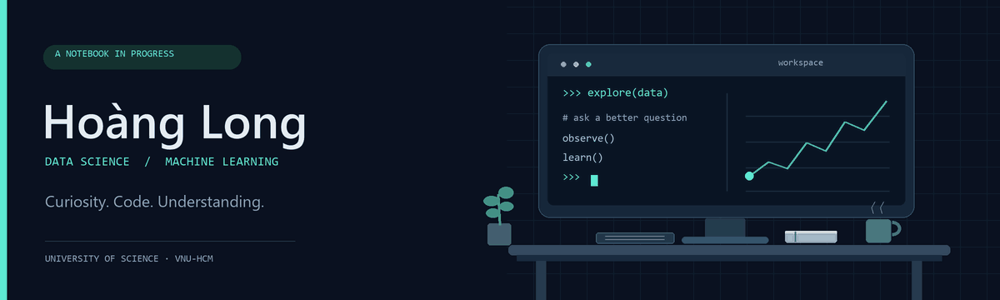

<picture>
  <source media="(prefers-reduced-motion: reduce)" srcset="assets/workspace.png">
  
</picture>

# Hi, I'm Nguyễn Hữu Hoàng Long

**Data Science · Machine Learning · Data Analysis**

I'm a student at the **University of Science, VNU-HCM**, with an interest in Data Science and Machine Learning. I'm developing my skills in programming, databases, and data analysis, with the goal of pursuing a research-oriented career.

## Skills & foundations

| Area | Background |
| :--- | :--- |
| Programming | Python · C++ |
| Data | Databases · Data Analysis |
| Machine Learning | Machine Learning foundations |

## Let's connect

[Email](mailto:long0889495767@gmail.com) · [LinkedIn](https://www.linkedin.com/in/nguyen-long-395865391/)

---

Learning through code, exploring through data.
